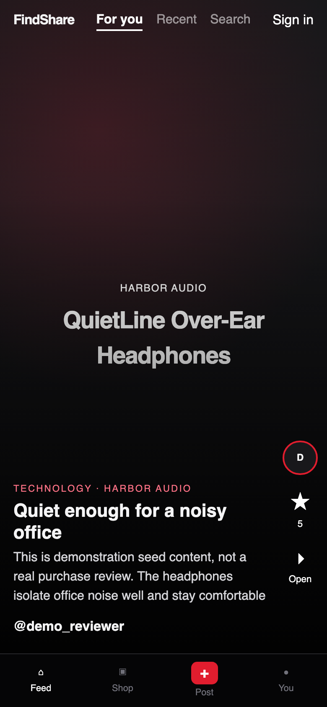
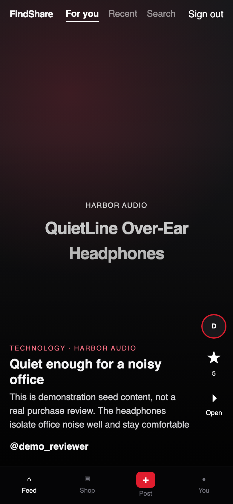

# FindShare

Enterprise Java application example

FindShare is an invitation-only social product-discovery platform where users share reviews, ratings, recommendations, images, prices, and shopping information across consumer-product categories. It includes secure media uploads, AI-assisted moderation, human review, and production-style AWS infrastructure managed with Terraform, EKS, Helm, and GitHub Actions.

**Current implementation status:** Phase 1 (local foundation). Later phases are documented, not implemented. See [docs/implementation-plan.md](docs/implementation-plan.md).

| Claim | Status |
| --- | --- |
| Local JWT auth, profiles, products, text reviews, ratings, feed, search | Implemented in Phase 1 |
| Docker Compose local stack | Implemented in Phase 1 |
| Image uploads, YOLO, human moderation | Deferred to Phase 3 |
| AWS, Cognito, EKS, Helm, live ads | Deferred to Phases 4–6 |
| Scale, cost, and revenue numbers | Roadmap / estimated only — not measured |

## Stage 1: private development

Invitation-only registration. Image uploads, comments, live ads, and public collections are disabled in Phase 1.

```bash
cp .env.example .env
docker compose up --build
```

- Web: http://localhost:3000
- API: http://localhost:8000
- API health: http://localhost:8000/health
- OpenAPI: http://localhost:8000/docs

If those host ports are already taken, override them (see [docs/local-development.md](docs/local-development.md)).

Seeded local accounts (development only, labeled demonstration data):

| Role | Username | Email | Password |
| --- | --- | --- | --- |
| admin | `admin` | `admin@example.com` | `FindShareAdmin!dev` |
| moderator | `moderator` | `moderator@example.com` | `FindShareMod!dev` |
| demo reviewer | `demo_reviewer` | `demo.reviewer@example.com` | `FindShareDemo!dev` |

Invitation codes are required for new registration. Local development code: `FINDSHARE-DEV-INVITE`.

## Screenshots

Phase 1 local UI. Seeded reviews and products are **demonstration data**, not real purchases.

<p>
  
  
</p>

| Screen | File |
| --- | --- |
| Invitation-only registration | [03-register.png](docs/screenshots/03-register.png) |
| Sign in | [02-sign-in.png](docs/screenshots/02-sign-in.png) |
| Shop / catalog | [04-products.png](docs/screenshots/04-products.png) |
| Product detail | [05-product-detail.png](docs/screenshots/05-product-detail.png) |
| Published review | [06-review.png](docs/screenshots/06-review.png) |
| Search | [07-search.png](docs/screenshots/07-search.png) |
| Profile | [09-profile.png](docs/screenshots/09-profile.png) |
| Write a text review | [10-write-review.png](docs/screenshots/10-write-review.png) |

Full set: [docs/screenshots/](docs/screenshots/).

## Notices

Reviews, ratings, product details, prices, and availability may be submitted by users and may contain errors. FindShare does not independently guarantee product quality, safety, authenticity, suitability, or availability. Verify important product information with the manufacturer or retailer before purchasing or using a product.

User content is not medical, nutritional, health, or safety advice. Consult a qualified professional when appropriate and follow manufacturer instructions and warnings.

Prices and availability may vary by retailer, location, product variant, and date. Verify current pricing and availability with the retailer before purchasing.

Legal templates in `docs/legal/` require qualified legal review before any public release.

## Repository layout

```
apps/web                 Next.js consumer app
apps/admin               Moderator/admin dashboard (Phase 3+)
services/api             FastAPI backend
services/*-worker        Background workers (Phase 3+)
packages/shared-types    Shared TypeScript types
infrastructure/terraform AWS IaC (Phase 4+)
infrastructure/helm      EKS charts (Phase 6)
docs                     Architecture, runbooks, roadmaps
tests                    Integration, e2e, load (later phases)
```

## Tests

```bash
docker compose exec api pytest -q
docker compose exec web npm test
```

Do not treat unrun tests, planned AWS environments, or roadmap scenarios as completed work.

## Documentation

Interviewer starting point: [docs/interview-package.md](docs/interview-package.md) and the 10–15 minute script in [docs/interview-demo.md](docs/interview-demo.md).

Then [docs/implementation-plan.md](docs/implementation-plan.md), [docs/local-development.md](docs/local-development.md), and [docs/api-contracts.md](docs/api-contracts.md).
