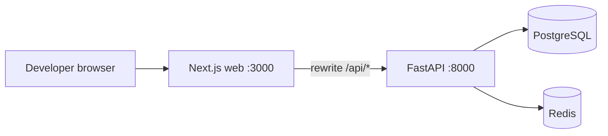
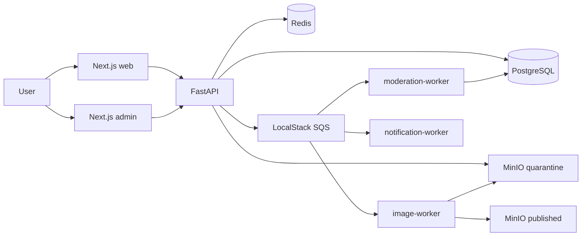
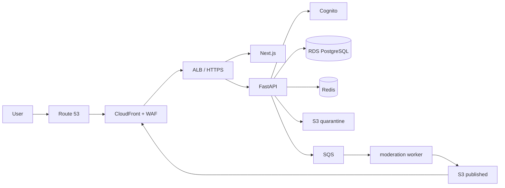
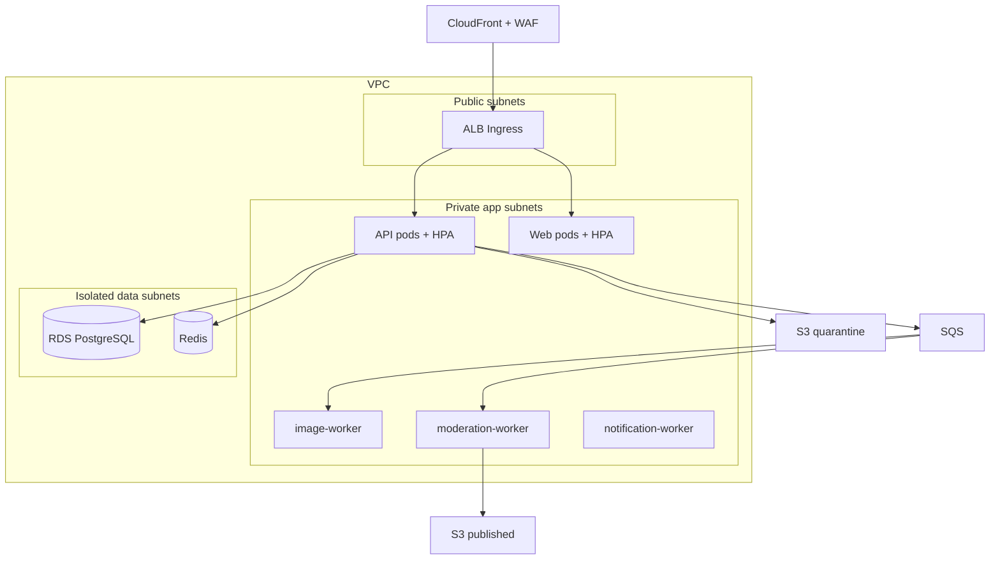

# Architecture

**Status:** Phase 1 local architecture is **Implemented**. Beta and EKS diagrams are **Roadmap only** until Terraform/Helm are applied.

## Local architecture (Phase 1 — implemented)

Compose services in Phase 1: `web`, `api`, `postgres`, `redis`.

MinIO, LocalStack, image/moderation/notification workers, and the admin dashboard are **Deferred** to Phase 3+. They appear in the target local architecture below.

## Target local architecture (Phase 3+ — deferred)

## Invitation-only beta architecture (Phase 5 — roadmap only)

Not deployed. Creating this environment is optional and should be destroyed after demonstrations.

## EKS interview architecture (Phase 6 — roadmap only)

Independently deployable and destroyable. No live cluster exists in Phase 1.

## Auth model (Phase 1)

Local JWT provider. Access token `sub` is the user UUID. Each request loads the user from PostgreSQL. Role and status come from the database, not the token payload and not the client. Logout records the JWT `jti` in Redis until expiry. Cognito replaces this provider in Phase 4 behind the same application interface.

## Publication boundary (all phases)

Unpublished reviews must not appear in feed, search, public profiles, or public API list endpoints. Enforced in API queries, not in the frontend.
