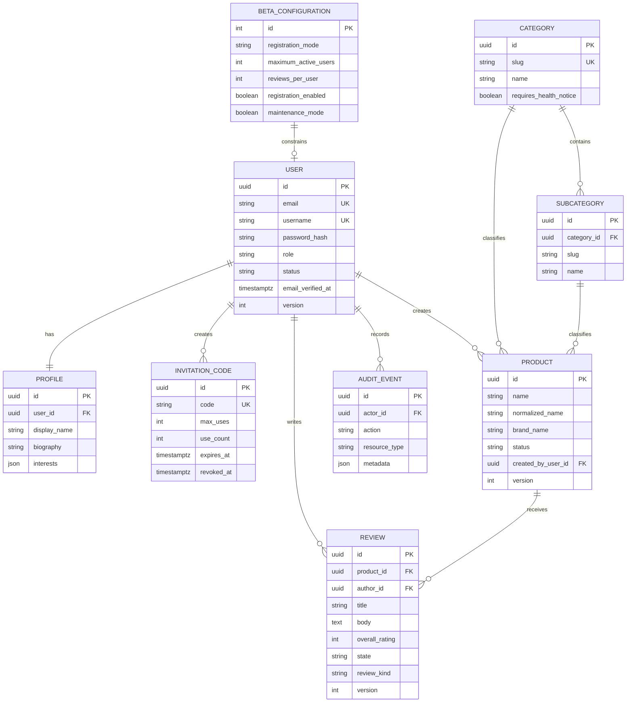

# Data model

**Status:** Phase 1 tables are **Implemented**. Remaining entities are **Deferred** (schema planned, not migrated).

## Phase 1 entity-relationship diagram

## Planned full model (deferred)

User, Profile, InvitationCode, BetaConfiguration, Category, Subcategory, CategoryAttribute, Brand, Product, ProductVariant, ProductAttributeValue, ProductImage, Retailer, RetailerLocation, ProductListing, ProductPrice, Review, ReviewRating, ReviewImage, ReviewDisclosure, ReviewComparison, HelpfulVote, Like, Comment, Follow, Block, Collection, CollectionItem, Notification, Report, ModerationJob, ModerationFinding, ReviewCase, ReviewDecision, Appeal, PolicyVersion, FeatureFlag, AdPlacement, MockAdEvent, AuditEvent, CostAssumption, ScalingTestResult.

Phase 1 uses `brand_name` on Product rather than a Brand table. Category-specific attribute definitions arrive in Phase 2.

## Constraints (Phase 1)

- Unique email and username on `users`
- Unique category slug; unique `(category_id, slug)` on subcategories
- Unique `(normalized_name, lower(brand_name))` among non-archived products
- Review `overall_rating` between 1 and 5
- Review `state` in `draft | pending_moderation | needs_review | published | rejected | archived | deleted`
- User `role` in `user | moderator | admin`
- Optimistic `version` columns on User, Product, Review
- Foreign keys with restrict/cascade as appropriate (reviews restrict product delete; profile cascades with user)

## Duplicate products

`normalized_name` lowercases, strips punctuation, and collapses whitespace. Administrators can merge products in a later phase; Phase 1 rejects exact brand+normalized-name duplicates at create time.
