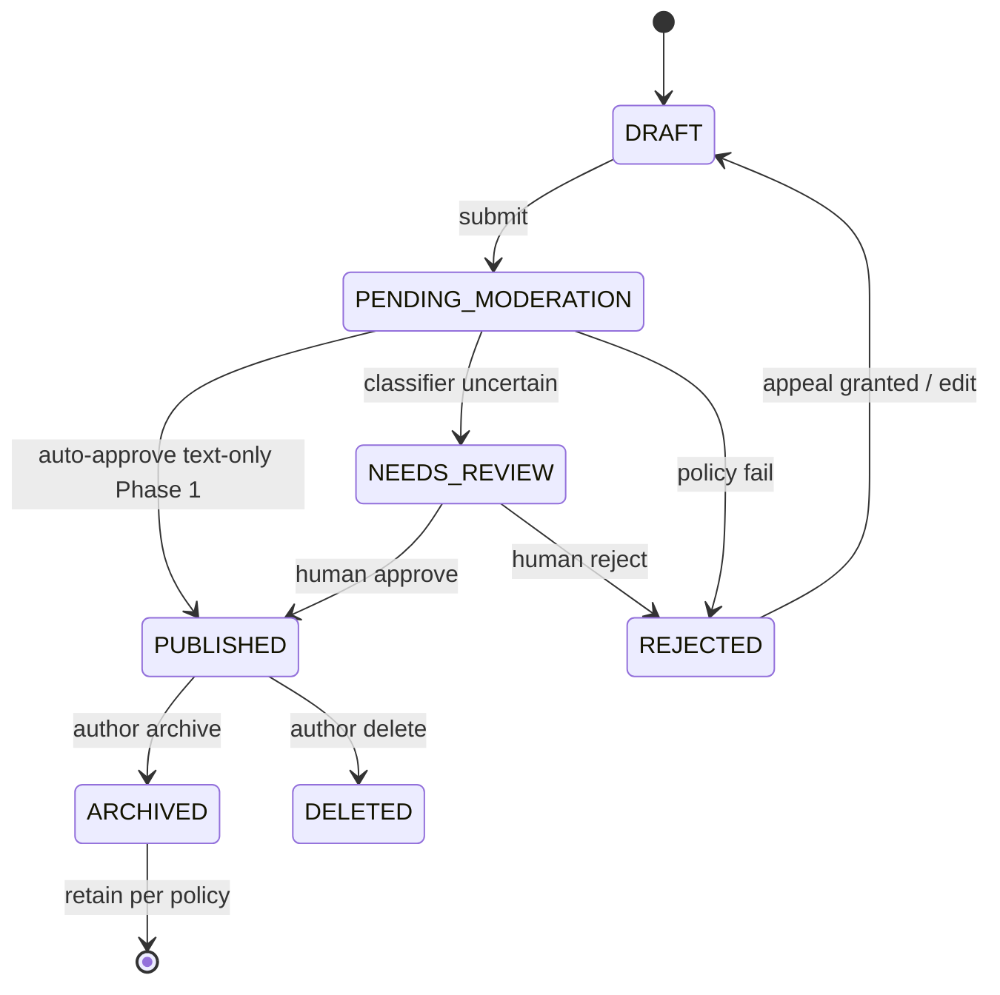
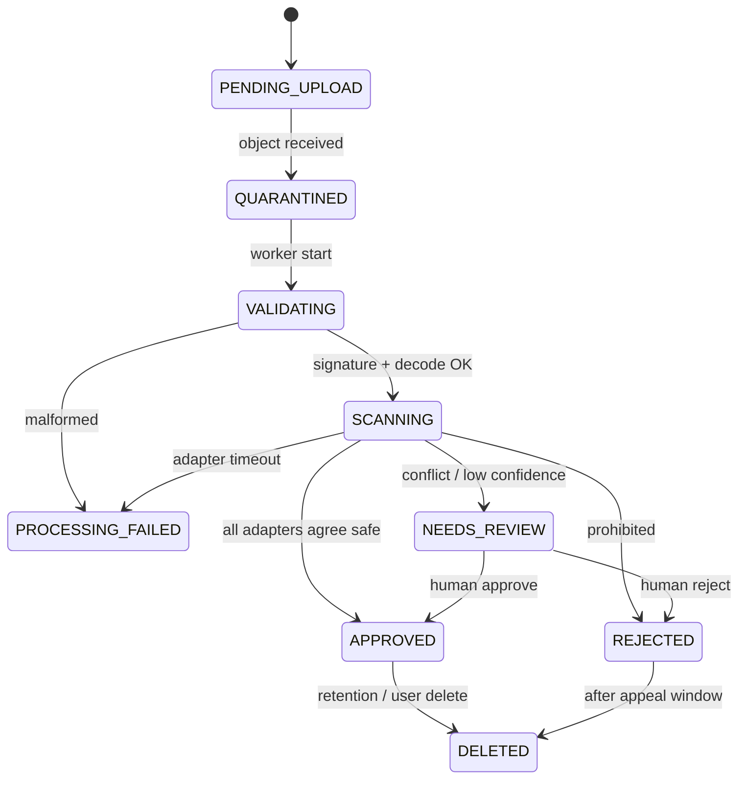

# Moderation pipeline

**Status:** State machines are **specified**. Image and AI moderation are **Deferred** to Phase 3. Phase 1 publishes **text-only** reviews under an explicit local gate: content starts as `draft` and becomes `published` only via the publish action. There is no image path.

YOLO is an object detector. It does not, by itself, guarantee content safety. Separate adapters are required for object detection, image-safety classification, OCR, text classification, spam, link safety, policy decisions, and human review.

## Review states

Phase 1 implements `DRAFT`, `PUBLISHED`, `ARCHIVED`, and `DELETED`. `PENDING_MODERATION`, `NEEDS_REVIEW`, and `REJECTED` columns exist so later phases do not break the contract; the Phase 1 publish path sets `PUBLISHED` only for the author-owned draft (no classifier). **Fail closed:** list/feed/search queries filter `state = published`.

## Media states (Phase 3 — deferred)

Never publish when moderation is incomplete, a required classifier fails, a worker crashes, processing times out, results conflict, an image is malformed, confidence is insufficient, or human review is pending.

## Publication gate

Enforced in:

- API serializers and list queries
- State-transition services
- Feed and search
- Public profiles
- Storage promotion and CloudFront (Phase 3+)

Not enforced solely in the frontend.
